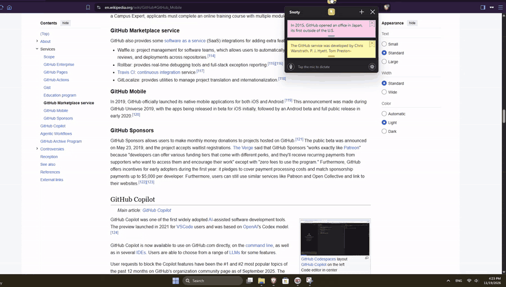
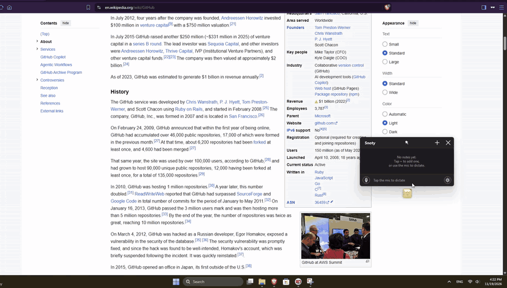
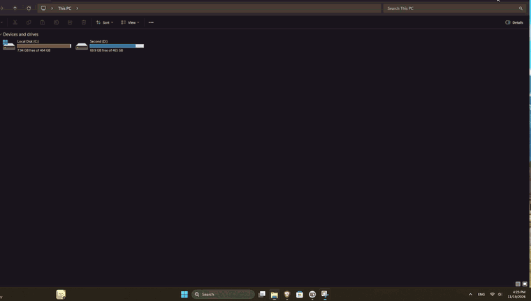
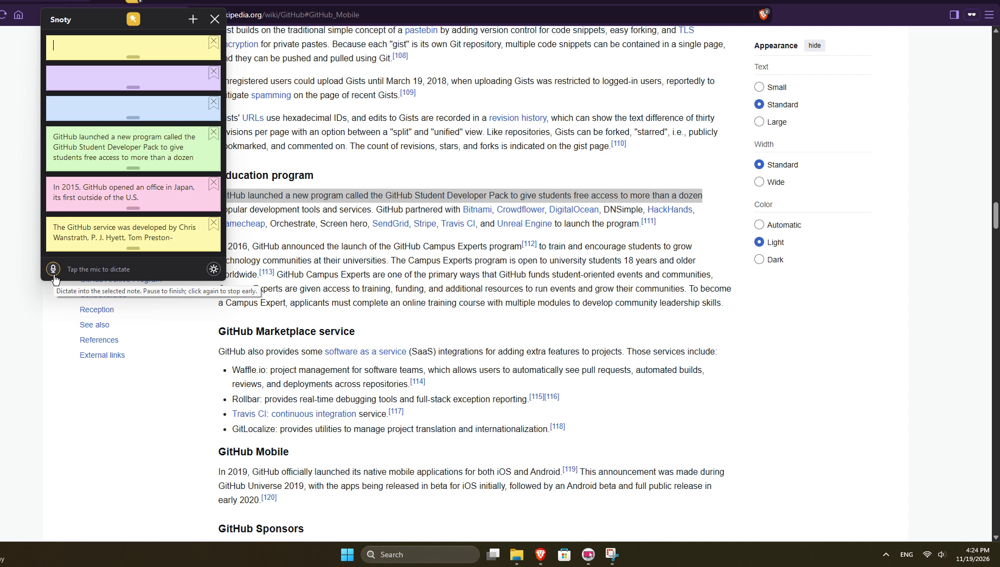
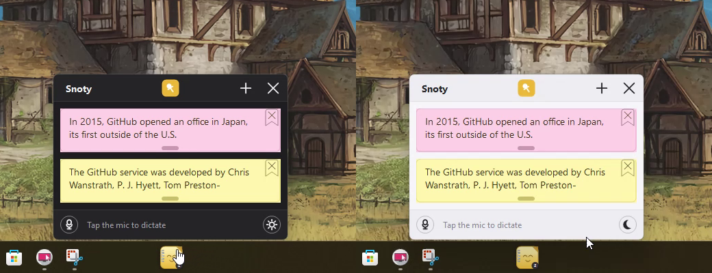

# Snoty

[-0078D4)](https://github.com/Brownfries/Snoty/releases/latest)

Tiny sticky note app for Windows that can be pinned anywhere on top of your open windows (or docked in the taskbar), with offline Whisper speech-to-text.

## Features

- **Stays above open windows**: Float the note icon anywhere on screen and pin the notes panel open so your notes stay visible on top of whatever you are working on.
- **Optional taskbar docking**: Drag the icon onto the taskbar if you want it parked in free taskbar space next to your buttons. Drag it off to float again.
- **Offline voice dictation**: Click the mic button to dictate into the active note using a bundled [whisper.cpp](https://github.com/ggml-org/whisper.cpp) build (`base.en q5_1`). Everything runs locally on your PC.
- **Light and dark mode**: Follows the Windows app theme by default, or toggle it manually with the sun/moon button while notes keep their paper colours.
- **Lightweight**: ~142 KB executable running on `.NET Framework 4.8` (already included in Windows 10 and 11).

## Screenshots

**Open and close from the floating icon (or pin it open above your window):**

**Open and close from the taskbar, or drag the icon out over any window:**

**Multiple note colours & offline voice dictation:**

**Dark & Light chrome themes:**

## Download

Get the latest build from **[Releases](https://github.com/Brownfries/Snoty/releases/latest)**:

- **[`Snoty-v1.0.0-win-x64.zip`](https://github.com/Brownfries/Snoty/releases/latest)** - Portable zip with `Snoty.exe` and the `whisper\` folder for offline dictation. Extract anywhere and run `Snoty.exe`.
- **[`Snoty.exe`](https://github.com/Brownfries/Snoty/releases/latest)** - Standalone executable.

## Controls

| Action | How |
| --- | --- |
| Open / close notes | Left-click the note icon (or tray icon) |
| Float or dock | Drag the icon anywhere on screen, or drop it onto the taskbar |
| Pin panel open | Click the pin button in the header |
| New note | Click `+` in the header or press `Ctrl+N` |
| Voice dictation | Click the mic button in the footer and speak |
| Note colour / order | Click the bottom bar on a note to change colour, or drag it up/down to reorder |
| Delete note | Click the top-right tab on the note |
| Menu & settings | Right-click the icon for **Start with Windows**, theme toggle, and **About** |

## Building from source

Run `build.bat` on Windows 10 or 11 (64-bit). It compiles `Snoty.exe` using the built-in Windows C# compiler (or Visual Studio if installed). Keep the `whisper\` folder next to `Snoty.exe` for offline dictation. Notes are saved in `%APPDATA%\Snoty`.

## Credits & License

- Offline dictation uses [whisper.cpp](https://github.com/ggml-org/whisper.cpp) (MIT) and the quantized `base.en` model.
- Released under the [MIT License](LICENSE).

Made by **[Brownfries](https://github.com/Brownfries)** • **[Support on Buy Me a Coffee](https://buymeacoffee.com/Brownfries)**

